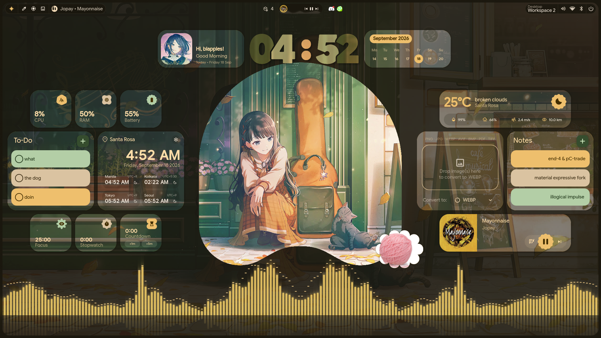

<div align="center">

# dots-chjwoo

Based on [pctrade/end4-pC](https://github.com/pctrade/end4-pC),
itself a fork of [illogical-impulse](https://github.com/end-4/dots-hyprland).

[English](README.md) | [简体中文](README.zh-CN.md) | [日本語](README.ja.md)

</div>

---

## Local carryovers

The shell follows `pctrade/end4-pC` (currently `81353515`, November 7, 2026)
with only these four local features:

- **Battery conservation mode:** `ChjwooUtils.qml` toggles the Lenovo
  IdeaPad/Legion charge cap and shows its status on hover.
- **Cheatsheet:** keybind reference and periodic table, opened with
  `SUPER + /` when the `quickshell:cheatsheetToggle` binding is configured.
- **Animated custom images:** GIF, WebP and MNG animation in the desktop
  custom-image widget, retaining upstream's resizing, shapes and drag/drop.
- **Targeted focus rules:** suppress activation requests from Telegram,
  Discord, Vesktop and WebCord without disabling browser activation globally.

The old bulk dotfile snapshot, installer, sync script, custom color controls,
Satty shortcut/button and terminal-theme write changes are not carried.
Inherited upstream features remain available; this is not a stripped-down
shell. `dotfiles/` now contains only the focus rules and battery udev rule.
Removing the snapshots does not remove applications or change live configs.

### Battery conservation setup

In Settings or Dashboard's bar layout editor, add **Battery conservation**
to a bar section. Its layout ID is `chjwooUtils`. Existing saved layouts
are not changed automatically.

The button requires this hardware attribute:

```bash
ls -l /sys/bus/platform/drivers/ideapad_acpi/VPC2004:00/conservation_mode
```

For users in the `wheel` group, install and apply the permission rule:

```bash
cd ~/.config/quickshell/dots-chjwoo
sudo install -m 644 dotfiles/system/60-ideapad-conservation.rules /etc/udev/rules.d/
sudo udevadm control --reload
sudo udevadm trigger -c bind -s platform
test -w /sys/bus/platform/drivers/ideapad_acpi/VPC2004:00/conservation_mode && echo writable
```

Restart the shell after applying the rule. A lock icon means the attribute
is not writable; the button hides on unsupported hardware. The widget and
rule currently target `VPC2004:00`; adjust both if your device differs.

### Focus rules setup

Keep your existing Hyprland configuration. Add this line to its
`~/.config/hypr/custom/rules.lua` rather than overwriting your rules:

```lua
dofile(os.getenv("HOME") .. "/.config/quickshell/dots-chjwoo/dotfiles/config/hypr/custom/rules.lua")
```

Reload Hyprland and restart the affected chat apps for the rules to apply.

### Following the parent fork

The `upstream` remote points to `https://github.com/pctrade/end4-pC.git`.
After committing local work, update with:

```bash
git fetch upstream
git merge upstream/main
```

Keep personal application settings outside this shell checkout; add only
small, intentional overrides instead of restoring an old complete config.

---

## 🎬 Showcase

<p align="center">
  <a href="https://www.youtube.com/watch?v=o0Vsh7eVchs">
    
  </a>
</p>

</div>

---

## 📸 Screenshots
<div align="center">

| 🎵 Lyrics | 🖼️ Online Wallpapers |
|:---:|:---:|
|  |  |
| 🪟 Desktop Widgets | 🔧 Hyprland Configs |
|  |  |
| ⚙️ Configurable Bar | ✨ And More |
|  |  |

</div>

---

## 🎨 Community Presets

Share your whole desktop with one button, or try someone else's in a click.

**[end4-pCpresets](https://github.com/pctrade/end4-pCpresets)** is the community gallery for this shell. Open **Dashboard → Presets**, pick a preset and press **Download** to try it or **Install** to keep it. Made your own? Press **Upload**, choose a screenshot and it is sent for you with one click. The first time, a terminal opens to install the [GitHub CLI](https://cli.github.com) (`gh`) and sign you in, which takes a minute. If you skip that, the shell opens a GitHub page where you drag the folder in instead. Changed your mind? **Remove from gallery** takes your own preset back out.

- 🔒 **Private by design:** nothing is collected from you. The shell only reads public files from GitHub.
- 🧹 **Clean exports:** personal paths, keys and commands are removed before anything is shared.
- ✅ **Every preset is checked** automatically. First-time authors are reviewed by hand, and trusted authors are merged automatically once the check passes.
- 👤 **Yours stays yours:** only the person who shared a preset can change or remove it.

[Browse the gallery](https://github.com/pctrade/end4-pCpresets) · [How to share yours](https://github.com/pctrade/end4-pCpresets#share-your-preset)

---

## ⚡ Installation

> [!NOTE]
> This fork manages its own configuration folder independently — it does **not** overwrite or modify any existing setup. However, it does require [illogical-impulse](https://github.com/end-4/dots-hyprland) to be installed and running.

```bash
cd ~/.config/quickshell/
git clone https://github.com/chjwoo7/dots-chjwoo.git
killall qs 2>/dev/null; qs -c dots-chjwoo > /dev/null 2>&1 & disown
```

### 🔧 Set as your default shell (optional)

To load this fork by default, add the following override to:

```bash
~/.config/hypr/custom/variables.lua
```

Set the shell configuration name:

```lua
hl.env("qsConfig", "dots-chjwoo")
```

Log out and back in for the environment change to take effect. To try the
shell in the current session, use the launch command above.

---

### ⚙️ Settings keybind

To open the settings panel, add this to your Hyprland config:

```lua
hl.bind("SUPER + escape", hl.dsp.global("quickshell:settingsToggle"), {description = "Toggle settings"})
```

> **Note:** Settings is an overlay panel, not a regular window — `Super + Q` won't close it. Use the same keybind to toggle it or press `Escape`.

---

## ❓ FAQ

### How do I see my keybinds?

Open the launcher (`SUPER`) and type `<` — it'll show you the full list of configured keybinds.

### Why doesn't Settings have a search bar?

It doesn't need one — the launcher already does that job. Open the launcher (`SUPER`) and just type what you're looking for (e.g. `wallpaper`, `bar`, `blur`); it'll match against page names and section keywords and jump you straight to the right Settings page, so there's no need for a separate search inside Settings itself.

---

## 🙏 Credits

Huge thanks to the people who made this possible:

- **[@end-4](https://github.com/end-4)** — for creating the original [dots-hyprland](https://github.com/end-4/dots-hyprland) / illogical-impulse shell. An absolute masterpiece of a dotfiles project 🫡
- **[@gh0stzk](https://github.com/gh0stzk)** — for providing the weather API integration that made the weather widget possible 🙌
- **[@StarS2112](https://github.com/StarS2112)** — for showcasing this fork 🙌
- **[@simeulinuxkaliaiwr](https://github.com/simeulinuxkaliaiwr)** — for some shader transitions 🎨

---

<div align="center">

Made with ❤️ — feel free to fork and make it your own

</div>
